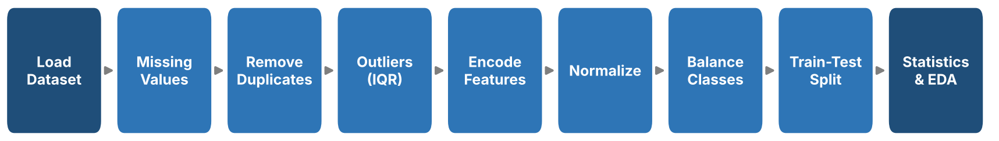
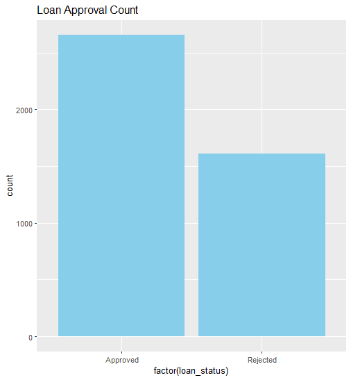
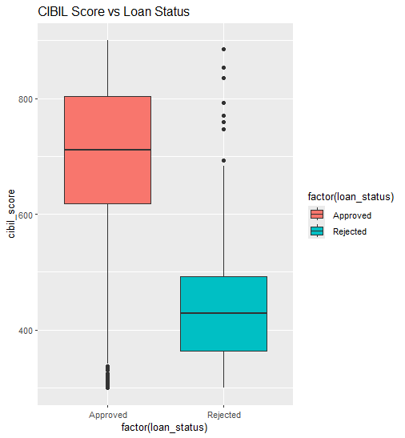
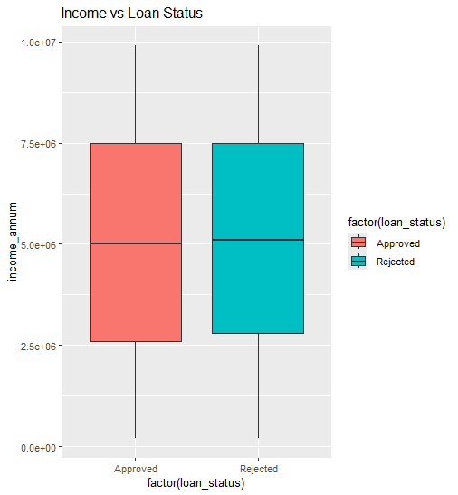
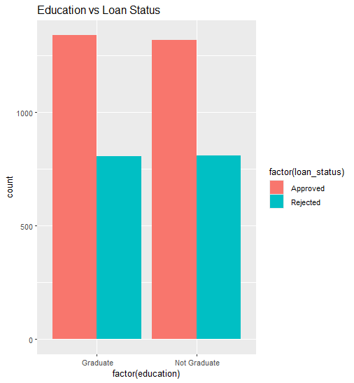

<p align="center">
  
</p>

<p align="center">
  
  
  
  
  
</p>

<p align="center">
  
  
  
</p>

<p align="center">
  <a href="#-overview">Overview</a> •
  <a href="#-dataset">Dataset</a> •
  <a href="#-data-preparation">Data Preparation</a> •
  <a href="#-key-findings">Key Findings</a> •
  <a href="#-visualizations">Visualizations</a> •
  <a href="#-getting-started">Getting Started</a> •
  <a href="#-report">Report</a> •
  <a href="#-team">Team</a>
</p>

---

## 📌 Overview

Banks decide on loan applications using applicant data such as income, credit score and assets. Raw data like this is often messy, with missing values, duplicates, outliers and imbalanced classes, which leads to unreliable analysis.

This project builds a complete **data preparation and exploratory data analysis (EDA) pipeline in R**. It turns the raw loan dataset into clean, model-ready data, then uses statistics and visualizations to find the factors linked to loan approval.

<table align="center">
  <tr>
    <td align="center"><h3>4,269</h3>Loan applications</td>
    <td align="center"><h3>13</h3>Features</td>
    <td align="center"><h3>15</h3>Preparation steps</td>
    <td align="center"><h3>~62%</h3>Approval rate</td>
  </tr>
</table>

> [!NOTE]
> Course project for **Introduction to Data Science**, American International University-Bangladesh (AIUB).

### 🔄 Workflow

<p align="center"></p>

---

## 📊 Dataset

**[Loan Approval Prediction Dataset](https://www.kaggle.com/datasets/architsharma01/loan-approval-prediction-dataset)** from Kaggle, with **4,269 records** and **13 columns**.

<details>
<summary><b>View all columns</b></summary>
<br/>

| Column | Description |
|---|---|
| `loan_id` | Unique application ID |
| `no_of_dependents` | Number of dependents |
| `education` | Graduate / Not Graduate |
| `self_employed` | Yes / No |
| `income_annum` | Annual income |
| `loan_amount` | Requested loan amount |
| `loan_term` | Loan duration (years) |
| `cibil_score` | Credit score (300 to 900) |
| `residential_assets_value`, `commercial_assets_value`, `luxury_assets_value`, `bank_asset_value` | Asset values |
| `loan_status` | 🎯 **Target**: Approved / Rejected |

</details>

---

## 🧹 Data Preparation

| # | Problem | Solution |
|:-:|---|---|
| 1 | Missing values | Empty strings to `NA`; categorical `NA` set to `"Unknown"`; numeric `NA` replaced with the mean |
| 2 | Extra spaces in text values | Trimmed with `strip.white` and `trimws()` |
| 3 | Duplicate records | Detected and removed with `duplicated()` |
| 4 | Outliers | IQR rule on annual income |
| 5 | Categorical features | Binary and factor encoding |
| 6 | Continuous features | Grouped into income and CIBIL categories |
| 7 | Different scales | Z-score standardization with `scale()` |
| 8 | Class imbalance | 70/30 train-test split first, then upsampling on the **training set only** |
| 9 | Invalid values | Checked for zero or negative income and loan amount |

> [!TIP]
> The data is split into training and test sets **before** balancing, so duplicated rows never leak into the test set.

---

## 🔍 Key Findings

| | Finding |
|:-:|---|
| ✅ | **About 62% of applications are approved** and 38% rejected, so the target is moderately imbalanced. |
| 💳 | **CIBIL score is the strongest factor:** the median score is about **710 for approved** applicants vs about **430 for rejected** ones. |
| 💰 | **Income barely differs** between approved and rejected applicants, so income alone does not decide approval. |
| 🎓 | **Education has little effect:** graduates and non-graduates have very similar approval counts. |
| 📈 | **Loan amount rises with income**, showing a strong positive relationship. |

---

## 📈 Visualizations

| Loan Approval Count | CIBIL Score vs Loan Status |
|:-:|:-:|
|  |  |

| Income vs Loan Status | Education vs Loan Status |
|:-:|:-:|
|  |  |

| Income vs Loan Amount | Income Distribution |
|:-:|:-:|
|  |  |

<details>
<summary><b>More plots</b></summary>
<br/>

| Income Density | Outlier Check (Boxplot) |
|:-:|:-:|
|  |  |

</details>

---

## 🚀 Getting Started

### Prerequisites
- [R](https://cran.r-project.org/) 4.x
- [RStudio](https://posit.co/download/rstudio-desktop/) (optional)

### Run the analysis

1. **Clone the repository**
   ```bash
   git clone https://github.com/AyonBhowmick/Loan_Approval_Data_Analysis.git
   cd Loan_Approval_Data_Analysis
   ```
2. **Add the dataset:** download `loan_approval_dataset.csv` from [Kaggle](https://www.kaggle.com/datasets/architsharma01/loan-approval-prediction-dataset) and put it in the `data/` folder.
3. **Run the script** from the project folder:
   ```bash
   Rscript loan_approval_analysis.R
   ```
   Or open `loan_approval_analysis.R` in RStudio, set the working directory to the project folder, and run it from top to bottom.

Missing packages (`tidyverse`, `caret`, `naniar`, `VIM`, `caTools`) are installed automatically on the first run. Every EDA plot is shown on screen and also saved as a PNG in the `output/` folder.

> [!TIP]
> Keeping the dataset somewhere else? Set the `LOAN_DATA_PATH` environment variable to the full path of the CSV file.

---

## 📁 Project Structure

```
Loan_Approval_Data_Analysis/
├── loan_approval_analysis.R      # full R script
├── data/                         # put loan_approval_dataset.csv here (not committed)
├── output/                       # EDA plots saved by the script (not committed)
├── images/                       # figures used in this README
├── report/
│   ├── Loan_Approval_EDA_Report_Group7.pdf
│   └── Loan_Approval_EDA_Report_Group7.docx
└── README.md
```

---

## 📄 Report

The full project report covers every step with code, outputs and figures.

<p align="center">
  <a href="report/Loan_Approval_EDA_Report_Group7.pdf"></a>
  <a href="report/Loan_Approval_EDA_Report_Group7.docx"></a>
</p>

**Contents:** Introduction, Dataset Description, Data Issues, Data Cleaning & Preparation (15 steps), Descriptive Statistics, Exploratory Data Analysis, Conclusion and Future Work.

---

## 👥 Team

| Name | Contribution |
|---|:-:|
| Ayon Kumar Bhowmick Ovi |  |
| Sheikh MD. Atik Shahoriyer Badhon |  |
| Dipu Roy |  |
| Sumiya Haider Risa |  |

**Supervisor:** Kamrun Naher Koli

---

<p align="center">⭐ If you found this project useful, consider giving it a star!</p>

<p align="center">
  
</p>
