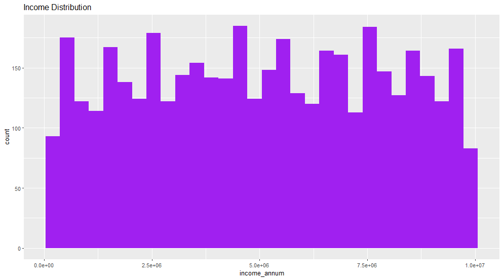
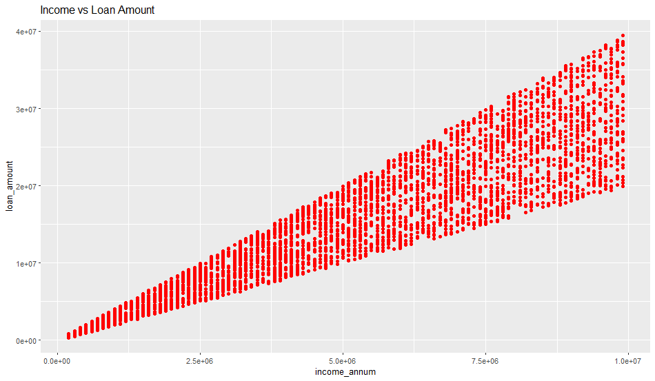
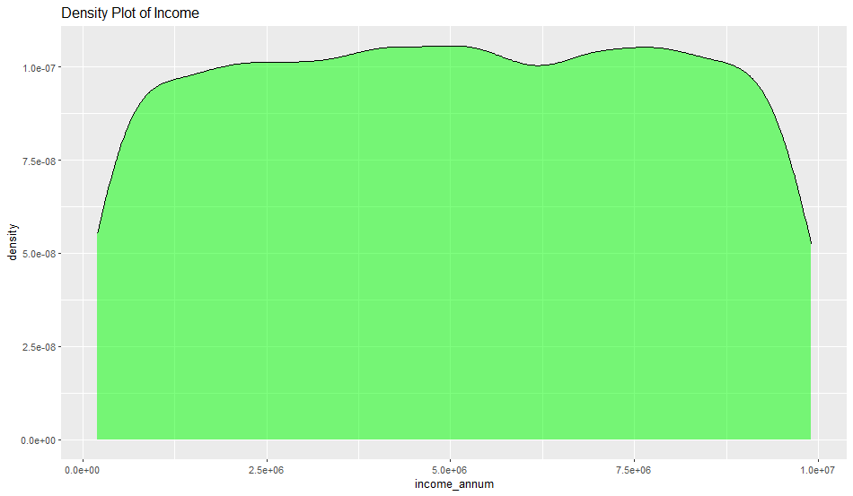
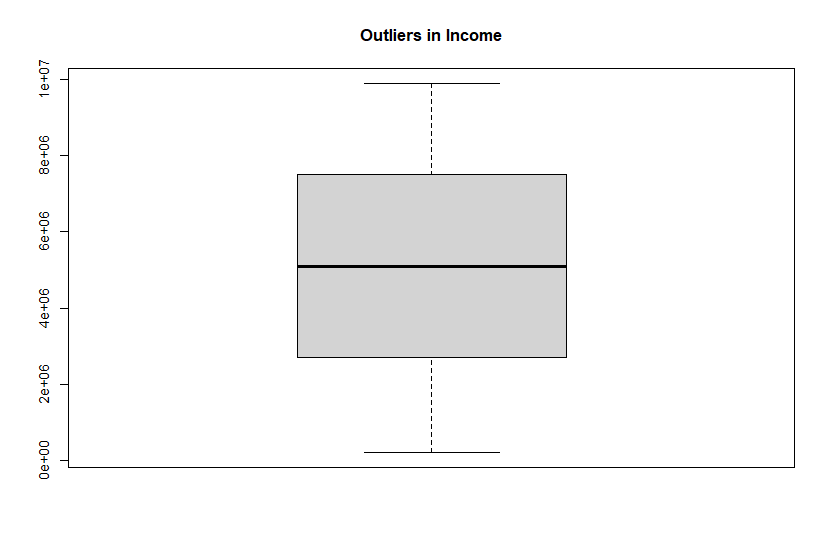

<h1 align="center">Loan Approval Data Analysis</h1>
<p align="center"><b>Data preparation, cleaning, and exploratory data analysis of a loan approval dataset in R</b></p>

<p align="center">
  
  
  
  
  
</p>

---

## 📌 Overview
Banks decide on loan applications using applicant data such as income, credit score, and assets. Raw data like this is often messy, with missing values, duplicates, outliers, and imbalanced classes, which leads to unreliable analysis.

This project builds a complete **data preparation and exploratory data analysis (EDA) pipeline in R** that turns the raw loan dataset into clean, model-ready data and uses statistics and visualizations to find the factors linked to loan approval.

> Course project for **Introduction to Data Science**, American International University-Bangladesh (AIUB).

---

## 🔄 Workflow
<p align="center"></p>

---

## 📊 Dataset
**[Loan Approval Prediction Dataset](https://www.kaggle.com/datasets/architsharma01/loan-approval-prediction-dataset)** (Kaggle): **4,269 records**, **13 columns**.

| Column | Description |
|---|---|
| `loan_id` | Unique application ID |
| `no_of_dependents` | Number of dependents |
| `education` | Graduate / Not Graduate |
| `self_employed` | Yes / No |
| `income_annum` | Annual income |
| `loan_amount` | Requested loan amount |
| `loan_term` | Loan duration (years) |
| `cibil_score` | Credit score (300 to 900) |
| `residential_assets_value`, `commercial_assets_value`, `luxury_assets_value`, `bank_asset_value` | Asset values |
| `loan_status` | **Target**: Approved / Rejected |

---

## 🧹 Data Preparation Steps
| Problem | Solution |
|---|---|
| Missing values | Empty strings to NA; categorical NA set to "Unknown"; numeric NA replaced with mean |
| Extra spaces in text values | Trimmed with `strip.white` and `trimws()` |
| Duplicate records | Detected and removed with `duplicated()` |
| Outliers | IQR rule on annual income |
| Categorical features | Binary and factor encoding |
| Continuous features | Grouped into income and CIBIL categories |
| Different scales | Z-score standardization with `scale()` |
| Class imbalance | 70/30 train-test split first, then upsampling on the **training set only** (no data leakage) |
| Invalid values | Checked for zero or negative income and loan amount |

---

## 📈 Sample Visualizations
| Income Distribution | Income vs Loan Amount |
|---|---|
|  |  |

| Income Density | Outlier Check (Boxplot) |
|---|---|
|  |  |

**Key observations**
- Annual income is spread fairly evenly across its range.
- Loan amount rises steadily with income, showing a strong positive relationship.
- No extreme income values remain after IQR filtering.

---

## 📁 Project Structure
```
Loan_Approval_Data_Analysis/
├── loan_approval_analysis.R      # full R script
├── data/                         # put loan_approval_dataset.csv here (not committed)
├── output/                       # EDA plots saved by the script (not committed)
├── report/
│   ├── Loan_Approval_EDA_Report_Group7.pdf
│   └── Loan_Approval_EDA_Report_Group7.docx
├── images/                       # figures used in this README
└── README.md
```

---

## ▶️ How to Run
1. Download `loan_approval_dataset.csv` from [Kaggle](https://www.kaggle.com/datasets/architsharma01/loan-approval-prediction-dataset) and put it in the `data/` folder.
   - Keeping it somewhere else? Set the `LOAN_DATA_PATH` environment variable to the full file path instead.
2. Open `loan_approval_analysis.R` in RStudio and set the working directory to the project folder (or run it from a terminal, see below).
3. Run the script from top to bottom. Any missing packages (`tidyverse`, `caret`, `naniar`, `VIM`, `caTools`) are installed automatically on the first run.
4. The EDA plots are shown on screen and also saved as PNG files in the `output/` folder.

From a terminal, in the project folder:
```bash
Rscript loan_approval_analysis.R
```

---

## 📄 Report
The full project report covers every step with code, outputs, and figures.

<p>
  <a href="report/Loan_Approval_EDA_Report_Group7.pdf"></a>
  <a href="report/Loan_Approval_EDA_Report_Group7.docx"></a>
</p>

**Contents:** Introduction, Dataset Description, Data Issues, Data Cleaning & Preparation (15 steps), Descriptive Statistics, Exploratory Data Analysis, Conclusion, and Future Work.
---

## 👥 Team
| Name | Contribution |
|---|---|
| Ayon Kumar Bhowmick Ovi | 33.4% |
| Dipu Roy | 33.3% |
| Sumiya Haider Risa | 33.3% |

**Supervisor:** Kamrun Naher Koli

---

<p align="center">⭐ If you found this project useful, consider giving it a star!</p>
